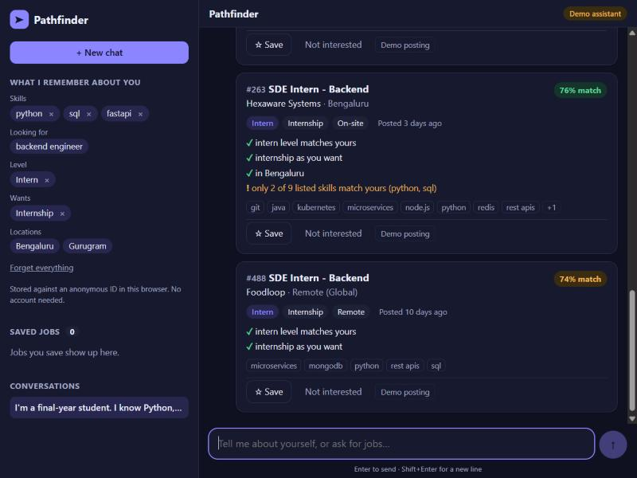
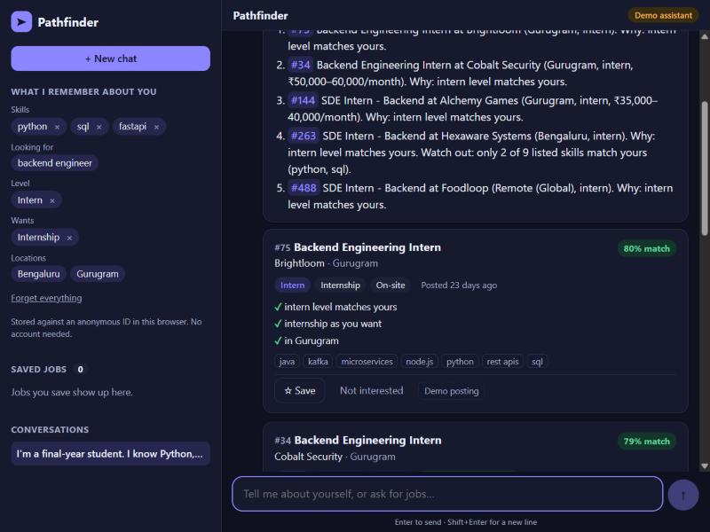
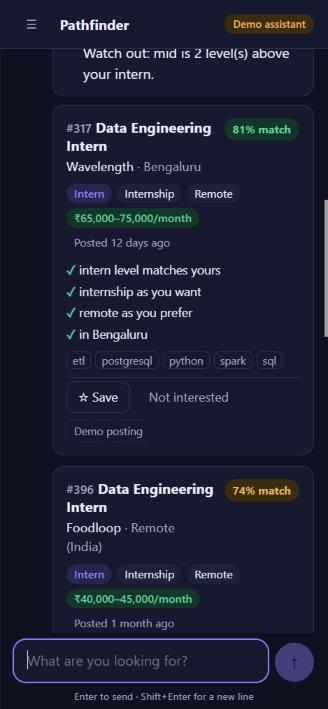

# Pathfinder: a conversational AI job-search agent

Chat with an agent that understands your skills and goals, searches a constantly-refreshing jobs index with hybrid
(semantic + keyword) retrieval, ranks results for *you*, explains every match, and remembers you between sessions.

| | | |
|---|---|---|
|  |  |  |

**Stack:** Python 3.12 · FastAPI · PostgreSQL 16 + pgvector · SQLAlchemy/Alembic · React 19 + TypeScript + Vite · Claude / OpenAI / Gemini (provider-agnostic) · Docker · GitHub Actions
**Runs with no API key and no Docker** (embedded Postgres + a built-in demo assistant); add a key for a real model.

## What it demonstrates

| Capability | What's built | Where to look |
|---|---|---|
| LLM agent with tool use + memory | Tool-calling loop with 9 validated tools, long-term profile memory in Postgres, rolling conversation summaries, a hallucination guard | `backend/app/agent/` |
| Structured outputs | Pydantic-validated tool arguments and results; invalid calls become errors the model can fix; typed final answers with a grounding report | `agent/tools.py`, `agent/grounding.py` |
| Retrieval, ranking, personalisation | pgvector + full-text hybrid retrieval fused with weighted RRF, then an explainable, profile-aware re-ranker fed by save/dismiss feedback | `backend/app/search/` |
| Semantic search over a changing index | Ingestion pipeline: idempotent upserts, content-hash change detection, incremental embedding, safe expiry with a circuit breaker, audit trail | `backend/app/ingest/` |
| Evaluating and improving LLM quality | Graded-relevance retrieval eval with dev/test split and ablations; 17-scenario agent suite with negative controls and an optional LLM judge; documented improvements *and a reversal of one of my own* | `backend/evals/`, [EVALS.md](EVALS.md) |
| Python backend, SQL, APIs | FastAPI, normalised schema with constraints and partial/GIN/HNSW indexes, migrations, SSE streaming | `backend/app/api/`, `app/db/` |
| Embeddings | Pluggable embedder interface (local ONNX model or offline hash) with change-aware re-embedding | `app/search/embedder.py` |
| Production readiness | Rate limits + daily cost cap, timeouts, structured logs, config validation, Docker, CI, deploy guide | `app/core/`, `.github/`, [DEPLOY.md](DEPLOY.md) |
| Front end | Streaming chat UI with live agent activity, explained job cards, editable memory panel; accessible and responsive | `frontend/` |

```
                       ┌───────────────────────── React UI (Vite) ─────────────────────────┐
                       │ chat · live tool activity · job cards · memory panel · save/dismiss│
                       └───────────────────────────────┬───────────────────────────────────┘
                                          POST /chat (server-sent events) · REST
 ┌─────────────────────────────────────────────────────▼─────────────────────────────────────────────┐
 │ FastAPI   rate limits · request ids · structured logs                                              │
 │  agent loop ──► LLM client (Claude | OpenAI | Gemini | mock) ──► tools ──► grounding check         │
 │      │                                                    │                                         │
 │  memory (history, profile, summaries)        search: keyword ┐                                      │
 │      │                                                 vector ┴─► RRF ─► explainable re-rank       │
 └──────┼────────────────────────────────────────────────────┼─────────────────────────────────────────┘
        ▼                                                    ▼
   PostgreSQL 16 + pgvector  ◄── ingestion (seed · Remotive · Arbeitnow): upsert · embed changes · expire
```

## Build history

Built in seven phases, each ending runnable and tested: (1) schema and data layer, (2) ingestion pipeline, (3) hybrid search and ranking,
(4) LLM layer and agent, (5) evaluation harness, (6) React UI, (7) hardening, CI, deploy guide and packaging.
Test status: **295 backend + 54 frontend tests**, lint-clean, CI builds both Docker images and smoke-tests the whole stack.

## Quickstart (no Docker needed)

Needs Python 3.12+ and Node 20.19+/22+. Two terminals:

```bash
# Terminal 1: the whole backend in one command (embedded Postgres + migrations + 520 demo jobs + API)
cd backend
python -m venv .venv
# Windows: .venv\Scripts\activate     macOS/Linux: source .venv/bin/activate
pip install -r requirements-dev.txt
python scripts/dev_stack.py            # http://127.0.0.1:8000  (data persists in backend/.pgdata; --ephemeral for a throwaway DB)

# Terminal 2: the chat UI
cd frontend
npm install
npm run dev                            # http://localhost:5173
```

It runs fully offline with a rule-based demo assistant (the UI says so). For a real model, copy `.env.example` to `.env` (at the repo root, which Docker Compose also
reads; `backend/.env` overrides it) and set `ANTHROPIC_API_KEY` (or `OPENAI_API_KEY` / `GEMINI_API_KEY`). Search, ranking, memory, saving and the streaming UI are identical either way.

Tests: `cd backend && pytest -q` (Postgres is embedded; no Docker) and `cd frontend && npm test`.

Or with Docker: `docker compose up --build`, then open http://localhost:8080 (loads the seed corpus automatically).

Live job sources and the CLI, without the UI:

```bash
python -m app.cli ingest       # seed + live Remotive + Arbeitnow
python -m app.cli chat         # talk to the agent in the terminal
python scripts/dev_db.py       # just the embedded Postgres, if you want to run uvicorn/alembic yourself
```

## The web app

React 19 + TypeScript + Vite, no UI framework (about 77 kB gzipped). It consumes the same `/chat` event stream described below.

| Feature | Notes |
|---|---|
| Live agent activity | While the assistant works you see *what it is doing* ("Searching jobs for “backend”…", "Remembering what you told me") as the tool calls stream in, not a spinner. |
| Job cards that explain themselves | Match %, ✓ reasons, and ! watch-outs straight from the ranker (e.g. "only 2 of 9 listed skills match yours"); salary, level, work mode, skills; `#id` references in the reply scroll to the card. |
| Personalisation loop | Save / "Not interested" call the feedback API (optimistic, with rollback on failure); dismissed jobs never reappear and similar ones rank lower. |
| "What I remember about you" | The saved profile, visible and editable: forget a skill, clear a field, or forget everything. Transparent memory is a trust feature. |
| Conversations | Resume past chats; cards are rebuilt from the job ids cited in stored replies. |
| Honest labelling | A "Demo assistant" badge when no AI key is configured; fictional seed postings are marked "Demo posting" (no dead Apply links); Remotive/Arbeitnow jobs are credited ("via Remotive"). |
| Robustness | Stop button (aborts the stream), retry on retryable errors, a clear "can't reach the server" screen with the command to run, anonymous identity that survives reloads. |
| Accessibility | Landmarks, a live-region message log, labelled controls, visible focus, keyboard-first composer (Enter / Shift+Enter), reduced-motion support, light/dark themes, responsive down to phone width (the sidebar becomes a drawer). |
| Security | Model output and job text are rendered as React elements, never as HTML; links are `noopener noreferrer`; only http(s) is linkified. |

Design notes: the browser only ever calls `/api/*` (Vite's dev proxy and nginx both strip the prefix), so there is no CORS and no API URL baked into the bundle. EventSource can't POST, so the stream is read with `fetch` and a small incremental SSE parser that is tested against every possible chunk-boundary split.

Frontend verification: 54 tests (reducer, SSE parser, text renderer, stream client, and the whole `<App/>` against a fake server whose stream the test controls step by step), a production build, and a manual pass in a real browser at desktop and phone width.
That manual pass found two real bugs the tests couldn't (a layout bug that made the whole page scroll, and a StrictMode race that could silently switch you to a different anonymous user); both now have fixes, and the second a regression test.

## Ingestion pipeline

The jobs index is meant to change constantly, so ingestion is a real pipeline, not a one-off script.

```
source.fetch() → normalise → dedupe → upsert (content-hash) → embed only what changed → expire → audit row
```

| Concern | How it's handled |
|---|---|
| Idempotency | `(source, external_id)` unique key + SHA-256 `content_hash`. Re-running identical data = 0 inserts, 0 updates, 0 embeddings. |
| Incremental embedding | `embedded_hash` records which content a vector was built from, so only new/changed jobs are embedded, and a crash mid-run self-heals next run. |
| Expiry | Jobs are never deleted (saved jobs and chat history must keep working); they get `expired_at`. Full-snapshot sources (seed, Remotive) expire what's missing; rolling-window sources (Arbeitnow) expire after `JOB_STALE_AFTER_DAYS`. Expired jobs that reappear are revived, not duplicated. |
| Circuit breaker | If a snapshot fetch returns < 50% of the currently-active jobs (API outage / partial response), expiry is skipped and the run notes why. |
| Failure isolation | A failing or malformed source is recorded as a failed run and never raises or expires anything; one bad row never sinks a run; one source failing doesn't stop the others. |
| Politeness | One request per Remotive run, per-source minimum intervals, retries with exponential backoff and `Retry-After` support, hard timeouts. |
| Data quality | HTML stripped to text, 90-skill taxonomy with aliases (`postgres` → `postgresql`), seniority/job-type/salary/country inference, English-only and tech-only filters for Arbeitnow, keyword-stuffed postings capped at 12 ranked skills. |
| Auditability | Every run writes an `ingestion_runs` row (fetched / inserted / updated / unchanged / expired / embedded / status / error), surfaced at `GET /stats`. |

Commands: `python -m app.cli ingest [--source seed|remotive|arbeitnow|all] [--force] [--no-expire]`,
`python -m app.cli loop --interval-minutes 360` (scheduler-less recurring ingestion), `python -m app.cli stats`.

## Search and ranking

```
query ─► expand aliases (k8s→kubernetes) ─┬─► pgvector cosine (HNSW) ──┐
                                          └─► Postgres full-text (GIN) ─┴─► RRF fusion ─► personalised re-rank ─► explained results
         hard filters (SQL): seniority, job type, work mode, location, skills, recency, company, exclusions
```

* **Two retrievers, fused by rank (RRF).** Embeddings catch meaning; full-text catches exact tokens ("C++", a city, a framework).
  RRF merges the *rankings*, so the raw scores never need to be comparable. Full-text uses OR semantics
  (`python backend pune` doesn't require all three words), via `plainto_tsquery` so arbitrary user text can't inject query syntax.
* **Hard constraints vs. soft preferences.** Filters are applied in SQL before retrieval; preferences (seniority, work mode,
  location, salary, skills) only *re-rank*, so a thin profile never hides good jobs.
* **Explainable re-ranker** (`app/search/rerank.py`): a transparent weighted sum of 9 features: query relevance, skill overlap,
  seniority fit, job type, work mode, location, salary (INR only, annualised), recency (21-day half-life) and feedback affinity
  (skills/companies of jobs you saved vs dismissed). Features that can't be assessed are dropped and weights renormalised, so
  sparse profiles aren't penalised. Every result carries its component breakdown plus human-readable `reasons` and `caveats`.
  It's deliberately not an LLM call: it's free, instant, deterministic, testable and every point of the score can be explained.
* **Feedback loop.** `saved` / `dismissed` are first-class (`/users/{id}/feedback`); dismissed jobs are never shown again,
  saved ones shape future rankings, and saving a dismissed job cancels the dismissal.
* **Profile memory.** `PATCH /users/{id}/profile` merges lists (telling us you also know SQL doesn't erase Python) and rejects
  unknown fields (so a typo in an LLM-generated tool call fails loudly instead of silently doing nothing).
* **Ablation switches** (`mode=hybrid|vector|keyword`, `rerank=true|false`) exist so Phase 5 can measure what each stage adds.

```bash
python -m app.cli search "python backend" --skills python,sql,fastapi --seniority intern --job-type internship --location Gurugram,Bengaluru
python -m app.cli search --roles "machine learning engineer" --skills python,pytorch   # recommendations from profile alone
curl -X POST localhost:8000/search -H 'content-type: application/json' \
  -d '{"query":"llm agents","filters":{"work_mode":["remote"]},"profile":{"skills":["python"],"seniority":"junior"}}'
```

Design note worth knowing: query relevance is the RRF score divided by its theoretical maximum (an *absolute* 0..1). Scaling it
min-max across the candidate pool was tried first and rejected: it inflated a meaningless tie between two near-identical jobs
into a full 0..1 gap that overrode personalisation (caught by a test).

## The agent

```
POST /chat (SSE) ─► run_turn ─► [ LLM ─► tool calls ─► LLM … ] ─► grounding check ─► answer + job cards
                       │               search_jobs · get_job · update_profile · save/dismiss · compare · explain_match
                       └─ memory: message history (JSONB) · saved profile (long-term) · rolling summary
```

```bash
python -m app.cli chat                 # terminal chat; uses the mock LLM until an API key is set
python -m app.cli chat -m "I'm a student who knows Python and SQL. Find me a backend internship in Gurugram"
curl -N -X POST localhost:8000/chat -H 'content-type: application/json' -d '{"user_id":"<uuid from POST /users>","message":"find me ML jobs"}'
```

Events on the stream: `conversation` → `tool_call` / `tool_result` (as they happen) → `message` (final text, job cards, grounding report, usage) or `error`.

**Providers.** Set one key: `ANTHROPIC_API_KEY` (default, model `claude-opus-5-5`), `OPENAI_API_KEY`, or `GEMINI_API_KEY` (via Google's
OpenAI-compatible endpoint); `LLM_MODEL` overrides the model and `OPENAI_BASE_URL` points at Ollama/vLLM. With no key, a deterministic
rule-based **mock LLM** runs, so the whole product works offline. The mock demonstrates the plumbing (tools, memory, grounding,
streaming); it is not a measure of language-model quality. Claude Opus 5.5 is the most capable and most expensive default; for a
cheap demo set `LLM_MODEL=claude-sonnet-5-5` or `claude-haiku-5-5`.

**What's engineered, and why**

| Concern | Approach |
|---|---|
| Tool use | 9 tools with Pydantic-validated arguments (`extra="forbid"`, so a hallucinated field is an error, not ignored). A bad call returns an `is_error` tool result the model can read and fix; it never raises. Each call runs in a DB savepoint. |
| Structured outputs | Tool arguments/results are typed models; the final answer carries a structured grounding report and job cards. |
| Hallucination guard | Every `#id` the assistant cites must have been returned by a tool *this turn*. If not, the turn is retried once with a notice; if it still cites phantom jobs, they're marked "(unverified)" and no card is shown. |
| Prompt injection | Job descriptions are third-party text: tools label them untrusted, the system prompt forbids following instructions inside them, and tool output is size-capped. |
| Long-term memory | `update_profile` persists facts (merge semantics) to Postgres; they personalise every future search and conversation. |
| Short-term memory | Full message history in JSONB, with thinking/tool blocks stored exactly as returned. |
| Context growth | When history exceeds a token budget it is replaced by an LLM-written summary ("simple compaction"). Failure to summarise never breaks a chat. |
| Append-only history | Claude's preserved-thinking signatures are bound to the conversation prefix, and prompt caching is a prefix match. So the system prompt and tool list are constants, and dynamic context (date, saved profile, summary) is attached to user turns *when it changes* instead of rebuilding anything earlier. A test asserts every request extends the previous one byte-for-byte. |
| Model-specific correctness | Never sends `thinking`, `temperature`, `top_p` or forced `tool_choice` (all rejected by current Claude models); checks `stop_reason` (refusals, truncation) before reading content; `max_tokens` is sized for thinking. |
| Reliability | Step limit per turn, provider errors become terminal `error` events (retryable flag), unexpected crashes never leak internals or leave a stream hanging, SDK retries/backoff. |

**Verification status (honest version).** The Anthropic and OpenAI clients are tested by running the *real SDKs* against fake HTTP servers
(request shapes, response parsing, error mapping, thinking-block round-trips). I could not call the live APIs without keys, so behaviour
against the real services is unverified: run `python -m app.cli chat` with a key before relying on it.

## Evaluation

`python -m evals.run` (or `make eval`) spins up its own throwaway Postgres, runs everything through the real search/agent code, and writes [EVALS.md](EVALS.md).

**Retrieval** (49 queries, 6 categories, graded relevance judgments for *every* job so recall is exact, 33 dev / 16 test):

| Configuration | nDCG@10 | P@10 | MRR |
|---|---:|---:|---:|
| keyword only | 0.774 | 0.823 | 0.924 |
| + alias expansion (`k8s` → `kubernetes`) | 0.843 | 0.883 | 0.959 |
| vector only | 0.773 | 0.815 | 0.907 |
| **hybrid (weighted RRF)** | **0.868** | **0.912** | **0.980** |
| hybrid + re-ranking with the user's profile | 0.890 | 0.922 | 0.980 |

On queries judged for *personal fit*, profile-aware re-ranking lifts nDCG from 0.44 to 0.68 while topical precision also rises (0.74 → 0.83), i.e. personalisation didn't cost relevance.
Held-out `test` split: hybrid 0.862, with profile 0.884.

**What the harness did for the project.** It found and fixed real defects, and it also overturned one of my own earlier "improvements" (a text-truncation change that helped one narrow case but hurt the
shipped hybrid pipeline). Three knobs were tuned on `dev` and confirmed on `test`: the hash embedder's document recipe, the vector retriever's weight in rank fusion, and the re-ranker's recency weight.
A consistency check in the report fails loudly if the shipped defaults ever drift from what the selection rules choose. Details, including a failure analysis of the weakest queries, are in EVALS.md.

**Agent** (17 scenarios, 64 checks across tool selection, arguments, profile extraction, constraint satisfaction, grounding, memory, prompt-injection and sensitive-data safety):
runs with the real agent loop and tools against whichever provider is configured, plus *negative controls* (an agent that never uses tools, and one that obeys injected instructions and invents jobs) to prove the checks can fail:
the mock passes 17/17 and the controls pass 2/17 each. **The mock result is a regression test of the plumbing, not a quality score**; to measure a real model run `make eval-llm` (costs money, needs `--allow-paid`; add `--judge` for an LLM groundedness check).

**Limits to be upfront about.** The corpus is synthetic and generated from the same taxonomy the judgments use, so absolute numbers are an upper bound. Paraphrase queries ("protect applications from hackers") are the weak spot of the
lexical default embedder; measuring a real semantic model (`EMBEDDER=fastembed`) is the obvious next experiment and has not been run.

### Data sources and attribution

* **Seed**: 520 synthetic postings from fictional companies (`data/seed_jobs.jsonl`, regenerate with
  `python backend/scripts/generate_seed.py`). Keeps the project runnable offline and gives evals a corpus with known ground truth.
* **Remotive** (`remotive.com/api/remote-jobs`): its API terms require linking back to the Remotive URL and crediting
  Remotive, and ask clients to poll sparingly. We keep `url` pointing to Remotive, make one request per run, and enforce a
  6-hour minimum interval. **If you deploy this publicly, show "via Remotive" next to those jobs.**
* **Arbeitnow** (`arbeitnow.com/api/job-board-api`): free public API; please link back as well.

### Embeddings: be honest about what's running

`EMBEDDER=hash` (default) is feature hashing of words/bigrams: deterministic, offline, instantly reproducible, but it is
**lexical similarity, not semantic**. It exists for tests and the keyless demo. For real semantic search set
`EMBEDDER=fastembed` (`pip install -r backend/requirements-ml.txt`; local ONNX `bge-small-en-v1.5`, ~130MB one-time download),
then run `python -m app.cli reembed` once to rebuild existing vectors with the new model (new jobs use it automatically).

## Production notes

An anonymous chat endpoint that calls a paid model is a wallet with a public door, so it is protected in layers
(all configurable in `.env.example`): a per-user and a per-IP sliding-window rate limit, a **global daily turn cap** (a hard ceiling on the LLM bill), a signup limit,
a request-size cap, bounded LLM timeouts (the SDKs default to 10 minutes), sanitised request ids, security headers, and a startup check that logs
what is wrong for a public deployment when `APP_ENV=prod` (default DB credentials, localhost-only CORS, a real key with no limits, public docs).
Hosted Postgres URLs (`postgres://…`) work as-is. The limiters are in-memory and per process: correct for one instance, multiplied by the instance count if you scale out (move them to Redis).
**Deploying:** see [DEPLOY.md](DEPLOY.md). **CI** (`.github/workflows/ci.yml`): lint, backend tests against a real pgvector service, the eval suite as a regression gate, frontend typecheck/tests/build, an `npm audit` of runtime dependencies, and a Docker build plus full-stack smoke test of Compose (including a real chat turn through nginx).

## Known limitations

* Responses are delivered per step, not token-by-token (the UI sees each tool call live, then the final answer as one event).
* Reopened conversations show job cards without match percentages/reasons (those come from the live tool results and aren't stored).
* Claude's server-side refusal *fallbacks* are deliberately not enabled: echoing fallback blocks back correctly has intricate rules I couldn't
  verify without a key, and getting it wrong would silently corrupt history. Refusals are detected and handled gracefully instead.
* There is no real authentication: a user's UUID acts as a bearer secret (fine for a demo; rate limits and the daily cap bound the damage of abuse). Add accounts before storing anything sensitive.
* Jobs duplicated *across* sources (same posting on two boards) aren't merged yet.
* Filtered approximate search: HNSW can return fewer than `limit` rows under a very restrictive filter. `hnsw.ef_search` is
  raised to 100 and the keyword retriever fills the gap, but at large scale you'd use pgvector's iterative scans or partition by filter.
* Search quality with the default `hash` embedder is lexical. The semantic (`fastembed`) path is implemented behind the same
  interface but has **not** been run on the build machine (model download was declined); verify it with `EMBEDDER=fastembed`.
* The profile `min_salary` is interpreted as annual INR and only compared with INR-denominated jobs.
* The Dockerfiles, Compose file and nginx config were written without Docker available on the build machine, so they were **not executed there**;
  CI builds and smoke-tests them on every push, and `docker compose up --build` is the one-command check on your machine. Everything else is tested
  against a real PostgreSQL 16 + pgvector.
* The real LLM providers (Anthropic, OpenAI, Gemini) were tested with the real SDKs against *fake* HTTP servers, never against the live APIs: run `make chat` and `make eval-llm` with your own key before relying on them.
# PathFinder

